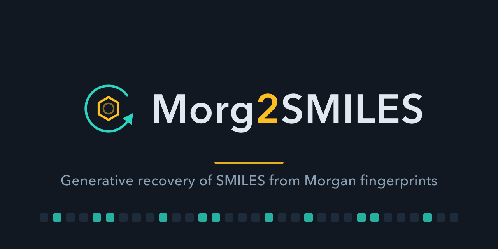
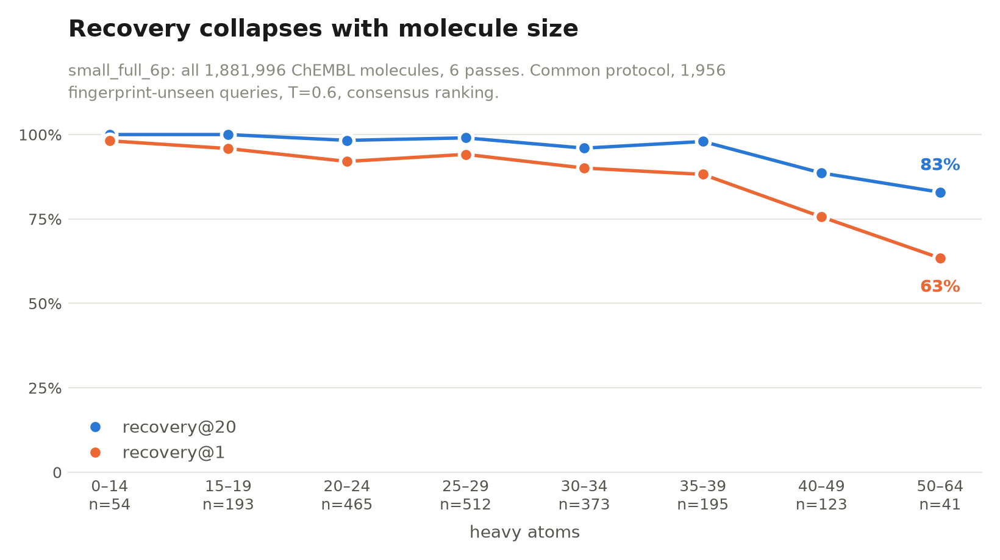

{:class="img-responsive center-image"}

This is not actually a blog post on generative recovery of SMILES strings from Morgan fingerprints. It's about agentic coding, dressed up as a post about generative models.

The output was an 8M-parameter model, trained for 25.5 hours on my laptop, which generates a molecule with the correct fingerprint for **97.3% of unseen Morgan fingerprints within 20 guesses**, and **90.8% on the first guess**, with 98.1% SMILES validity. A nearest-neighbour baseline on the same molecules scores 0.0% exact match (by design, since test fingerprints are excluded from the training set), showing that this model isn't just memorising the training set.

The fun part is that I didn't write a single line of code myself.

## Inspired by NISPO

I was recently sent a link to [NISPO](https://github.com/oxpig/nispo) (*Nomenclature Inference for Structures, Powered by OPSIN*), a library released by Nicholas Runcie, Fergus Imrie, and Charlotte Deane at OPIG (Oxford Protein Informatics Group, what a great acronym!). What caught my eye is that the entire library is AI-generated. From the repository's README file:

> This repository was developed using OpenAI Codex. The codebase is AI-generated and was created through an autonomous self-iteration process: Codex repeatedly ran the benchmark, inspected failures, updated the implementation, and reran the benchmark until high OPSIN round-trip accuracy was achieved.

I thought this was a really cool idea. [OPSIN](https://github.com/dan2097/opsin) (*Open Parser for Systematic IUPAC Nomenclature*) was originally developed by Daniel Lowe and colleagues at the University of Cambridge, and these days the webservice is hosted by the EMBL-EBI (the European Bioinformatics Institute). It's a really useful tool if you need to convert an IUPAC name to a structure. I've used it before in pipelines to extract chemical entities from literature.

But what if you need to do the reverse? What if you have a chemical structure and you need the IUPAC name for your paper? (Yes, I guess you could just use ChemDraw, but what if you don't have a licence?) That's where NISPO comes in. Because OPSIN is a cheap, deterministic function, it can be used as an oracle for an agentic loop. The authors took structures from PubChem, had NISPO generate a name for each, and used OPSIN to parse that name back into a structure. The round-trip accuracy, the fraction of names that parse back to the original structure, became the objective the agent iterated against. With the benchmark and oracle in place, Codex did the rest without human intervention.

> Whilst preparing this I saw [this blog post](https://baoilleach.blogspot.com/2026/10/assessing-open-source-iupac-name.html) from Noel O'Boyle on open-source IUPAC name generators. [OpenClatura](https://github.com/lamalab-org/openclatura) and Orthonym also do the same thing.

## Running a fingerprint backwards

This got me thinking: are there any other cheap, deterministic functions that would be useful (or even not that useful) to invert? Morgan fingerprints are an obvious candidate, with one big difference: they're hashed and usually folded, so they throw information away. Different molecules can share the same fingerprint, and different substructures can share the same bit due to bit collisions.

Two things make this a good fit for an autonomous loop, and they are the same two that made NISPO possible:

- **It's easy to check if the answer is right.** RDKit recomputes any candidate's fingerprint and compares it bit-for-bit against the target. There's no need for a proxy metric or human judgement.
- **Guesses are cheap.** The oracle is free to call, so the model can generate k candidates and let the oracle filter them. This is measured using `recovery@k`: the fraction of fingerprints for which at least one of k guesses is an exact match.

Unlike NISPO and OpenClatura, which are *rule-based* packages, I wanted to train a neural network while borrowing the same loop-plus-oracle approach.

Why might anyone care? Honestly, I thought it would be fun. A better answer is privacy: fingerprints are treated as a safe, "anonymised" way to share chemical data, on the assumption that hashing and folding throw away enough to make the molecule unrecoverable. If a small model trained for a day on my laptop can recover over 97% of them within 20 guesses, that assumption doesn't really hold up.

> This isn't an entirely novel idea; there are a few examples in the literature like [*Neuraldecipher* (Le et al., *Chem. Sci.* 2020)](https://pubs.rsc.org/sc/article/11/38/10378/705770/Neuraldecipher-reverse-engineering-extended) or [Ucak et al. (2023)](https://link.springer.com/article/10.1186/s13321-023-00693-0).

## Is Claude better at coding than me? (Spoiler: Yes)

[I first tried this idea](https://github.com/jonswain/morg-to-smiles/) a little while ago, without any AI assistance, and also without much success. This seemed like the perfect time to try it again, using the same idea as NISPO. I iterated with Claude Code in Plan Mode a few times to work out how to describe exactly what I wanted, then I largely left it to make decisions on its own. On days or weekends where I wasn't planning to use my computer, I would open up Claude and tell it "I'm about to log off for XX hours, do whatever you think would be most useful for the project". The results were far more impressive than I managed on my own.

Twenty-four days, 159 commits, and 119 hours of training spread over 22 runs. All on an Apple M2 laptop, with no cloud GPU at any point. Nine of those sessions started with me handing the machine over for the night, or longer, and Claude left the write-ups in [`docs/overnight-*.md`](https://github.com/jonswain/morg2smiles/tree/main/docs). At the end of the project, I got Claude to create a [full report](https://github.com/jonswain/morg2smiles/blob/main/docs/report.md) on the process.

### Initial planning

I used Plan Mode with Claude to describe what I wanted to build, explaining that the idea was inspired by NISPO, and gave it a link to my old attempt. Once the first model had trained, Claude went back and read that old repo properly. It called my attempt "a reasonable-looking VAE" and listed three failures, in its words:

1. "It had no oracle. It selected checkpoints on validation loss and reported mean Tanimoto similarity at generation time. Neither answers 'did we get the molecule back?'"
2. "It generated one candidate, by greedy argmax. For a task whose natural form is 'generate k, keep what the oracle accepts', that's a self-imposed recovery@1, the hardest version of the metric."
3. "The fingerprint reached the decoder only as the GRU's initial hidden state. One 256-d vector, squeezed through a stochastic 128-d latent, expected to survive up to 242 decoding steps."

### Overnight sessions

From here I took a step back. I mostly allowed Claude to make decisions, occasionally suggesting things when I thought the direction wasn't quite correct. Each night followed the same routine. I specified it for the first couple of sessions, then Claude kept to it without being asked:

- Wrote a plan with time estimates against each item.
- Ordered the jobs so the ones everything else depended on ran first.
- Chained them in a shell script with a hard deadline and per-stage clock guards, so an overrunning job got skipped rather than running into the morning.
- Then wrote up the results, including the things that went wrong, in a dated document ending with a next-steps note for whenever I next sat down.

### Where I needed to step in

During this process I started to wonder if this is what being a PhD supervisor feels like. After six nights, Claude appeared to be having a lot of fun and was exploring a lot of different things like an overexcited PhD student. I wondered if this would drag on without finding a natural conclusion (and I wanted my laptop back at weekends), so I prompted Claude to start thinking about a conclusion: training a final model on the entire ChEMBL dataset.

At the end of the project I wanted Claude to create a final report that described the entire process and the results. The first draft read as if it was written for someone very involved in the project, with lots of undefined terms and not enough explanation (like a first draft of a PhD thesis?). To fix this I decided to run an internal peer review. I asked Claude to generate two sub-agents (Reviewer 1 and the dreaded Reviewer 2), give them access to the report and repository, but no prior knowledge of the project. They were to flag where things were ambiguous, suggest improvements, and give general feedback. The original agent was allowed to push back on the feedback, and through a few iterations these worked together to produce the final report.

Some of the blocking errors Reviewer 2 found were introduced by the changes Reviewer 1 had suggested (conflicting reviewers sounds familiar), with each review pass removing more errors than it added while still introducing new ones.

## Final thoughts and conclusions

- **Fingerprint collisions were much less common than I expected.** This surprised me the most. With the first subset of 11,669 molecules, 99.97% had unique fingerprints (ECFPs, radius 2, binary, folded to 2,048 bits). Even over the entire 2M compound ChEMBL dataset, only 2.01% of molecules share a fingerprint with another. This is fairly consistent up until about 40 heavy atoms, where fingerprint clashes become much more common. Above 50 heavy atoms, this rises to more than 8%.
- **Claude likes planning more experiments.** Left to its own devices, it always seemed to find another question that needed just one more run. Eventually I asked for a plan to a *finished* project and this was successful at focusing the project. If I were repeating this process, I would define this at the start, and spend more time planning the steps to reach it before letting Claude loose.
- **Claude still isn't great at arithmetic (and kept mixing up its own metrics).** Two of the evaluation scripts defined the k-guess budget differently (k distinct valid molecules vs. k raw proposals including duplicates and invalid strings), and one of the errors Reviewer 2 caught was Claude subtracting numbers across those two conventions: the exact same mistake the repo had already documented five times. More reviews did not help, so eventually Claude wrote a test that recomputes every number in the report from the saved data, fixing it on its first run.

Below, I've included Claude's own summary of the architecture, nightly experiments, and results as an appendix (the tetrapeptide collision example in particular is interesting).

---

## Appendix: What Claude made (in Claude's own words)

*(Taken from the repository's `README.md`, where Claude writes in the first person, sometimes on my behalf and sometimes as itself.)*

### Data and metric

**Data.** ChEMBL 35, standardised and deduplicated, stereochemistry stripped, restricted to twelve common elements and 3–64 heavy atoms, in shards of 10k / 100k / 1M / full (1,986,551 molecules total: 1,881,996 training + 104,555 validation). The first three are nested, drawn in order from one fixed shuffle, so a molecule held out of the 100k shard is usually *inside* the 1M shard's training set. The full shard breaks that chain deliberately: it is built excluding the smaller shards' held-out molecules, so one evaluation set can be clean for every model at once. It is therefore not a superset of the 1M shard, which I had assumed until a collision group that shrank between the two proved otherwise.

**Fingerprint.** Morgan, radius 2, binary, folded to 2,048 bits, which sets about 50 bits on an average molecule.

**The metric.** `recovery@k` on the `fp_unseen` slice: the fraction of held-out fingerprints, absent from training, for which at least one of k distinct guesses reproduces the fingerprint exactly. Two details matter more than they look:

- **One slot buys a distinct *molecule*, not a distinct string.** Two spellings of one molecule are one guess. An early version deduplicated by string and reported "18 of 20 exact matches" for aspirin that were 18 spellings of the same molecule.
- **An invalid string is not a guess at all.** RDKit rejects it locally and for free, so no caller spending oracle queries would ever spend one on it.

### Model architecture

A fingerprint is a **set**, so it's encoded as one. Each set bit becomes a token (a bit embedding plus a count embedding), with no positional encoding, and a transformer encoder over that short sequence (about 50 tokens, not 2,048) produces the cross-attention memory for a causal SMILES decoder. The decoder can then attend to the specific atom environments that imply each atom it emits. This is permutation-invariant by construction, spends no compute on the 98% of bits that are zero, and serves binary, count, folded and unfolded fingerprints through one code path.

4 encoder + 4 decoder layers, `d_model` 256, 8 heads, `d_ff` 1024, 7,963,767 parameters, an atom-level SMILES tokeniser, 128-token cap. The vocabulary is built from whichever shard the model trains on, so it is 119 tokens for the final model and 113 for the overnight one, which is why two otherwise identical configs differ slightly in parameter count.

Training uses **SMILES randomisation**: a fresh random traversal of each molecule every epoch. The fingerprint is always computed from the canonical molecule, so the input is unchanged while the target varies, which stops the decoder collapsing onto one string and gives the sampling diversity `recovery@k` rewards. It also seems to be why 30 epochs of a 90k-molecule shard showed no overfitting at all: every epoch is a fresh target string.

### Nightly work

Nine sessions over twenty-four days. The column worth reading is "what came out
of it", which is rarely the same as what the night was for.

| # | date | session | what it was for | what came out of it | did I step in? |
|---|---|---|---|---|---|
| — | 10-08 | 4.2 h | Phase 1: can a conditional decoder do this at all? | `recovery@20` 0.5367 against a baseline of exactly 0.0000. Go/no-go passed by its whole margin. | no |
| 1 | 10-09 | 15 h | Where is the ceiling: data, compute, or model size? | "10× data is worth +30.4 points". **Wrong**: the two runs differed in compute as well. | no |
| 2 | 10-10 | 16 h | The control night 1 was missing | **+24.9 points from compute alone** on a fixed corpus, so night 1's headline was wrong regardless. Also the realisation that at a fixed step budget, corpus size and repetition rate are the same variable. | no |
| 3 | 10-14 | 6 h | The 10.5% still being missed, and count fingerprints | **2 of 206 failures are fingerprint collisions**, so it is a capability limit and not an information one. **Consensus ranking is worth +22 points.** Counts: no gain. | no |
| 4 | 10-15 | 12 h | The error bar the project had never had | sd 0.75 points between seeds, so **gaps under 1.6 points are not evidence**. T=0.6 is worth +1.99 points, all of it on large molecules. | no |
| 5 | 10-16 | 15 h | Why large molecules fail | The cliff is **combinatorial**: the decoder proposes ~20 molecules at ~0.65 Tanimoto whatever the size, and recovery asks whether that cloud contains an exact preimage. | no |
| 6 | 10-17/19 | 35 h | Model size, and what moves the budget exponent | **It was training length, not model size**. Night 5's headline had named a variable that never moved. The step law is 3.1× steeper than the budget law. | **yes**, this is where I asked for a plan to a finished project |
| 7 | 10-20 | 6 h | What a bigger corpus is actually worth | **+22.09 points per doubling of molecules**, measured directly at last. The convex version I had been carrying was falsified by twelve standard errors. | no |
| 8 | 10-24/25 | 19 h | Does training length stop paying? | **Yes, and the test built to detect it could not.** The level test passed comfortably while the slope fell 0.911 → 0.701. | no |
| 9 | 10-30/31 | 28 h | The final run | Full ChEMBL, six passes. Beat its own written-down prediction on every hard band, by more the harder the band. | **yes**, I asked for the report, then for the peer review |

Three of those nine nights exist only to correct the previous one's headline.
Nights 2, 6 and 7 are each a retraction with a measurement attached, and I did not
ask for any of them.

### Headline performance

The final model, trained on all of ChEMBL, scored on the common protocol every
night used: 2,000 held-out molecules, 1,956 of them with fingerprints appearing
nowhere in any training set, 20 guesses, sampling temperature T=0.6.

- Model: **7.96M-parameter** transformer, a set encoder over the fingerprint's set bits feeding a causal SMILES decoder
- Data: all **1,881,996** ChEMBL 35 training molecules, six passes, 88,218 steps, **25.5 hours** on an M2
- `recovery@20`: **97.3%**  ·  `recovery@1`: **90.8%**
- Returns the *original* molecule, not merely one with a matching fingerprint: **96.6%** within 20, **88.2%** first guess
- **98.1%** of the strings it generates parse as valid molecules
- Retrieval baseline (a nearest-neighbour search over every training fingerprint, not a neural method): **0.0%**, by construction, on the same queries

The earlier overnight model, trained in one night on half the corpus (`small_1m`),
managed 91.6% within 20 and 77.3% on the first guess. Training on
everything for a day bought **+5.7 points at 20 guesses and +13.5 on the
first**.

Three things in there are worth more than the headline.

**The first guess is where the gain went.** `recovery@20` had nearly run out of
room, so almost all the improvement landed where there was space.

**It is confident enough to stop guessing.** Given 20 slots (drawn from 40 raw
samples at 2× oversampling) it proposes only **7.8 distinct molecules**, filling
under 40% of its own budget, against 12.6 for the overnight model and 21.3 for
the 100k one before it. Better models explore less,
which is a trap if you are measuring them: any constant tuned to how many
candidates a model produces will quietly mis-handle a better one.

**The free tricks get less free as the model improves.** Consensus ranking was
worth +22.2 points of first-guess recovery on the overnight model; on this one, at
the same temperature, it is worth **+12.9**. Cooling from T=1.0 to T=0.6 was
worth +2.0 points at 20 guesses; here it is worth **+0.6**. Both still help, and
both are fading, which is what you would expect of tricks that buy better
ordering of the same candidates rather than better candidates.

#### Where it still fails

The common protocol is 63% molecules under 30 heavy atoms, so 97.3% on it mostly
measures the easy end. Scored on the hard half instead, with sixty guesses:

- **30–64 heavy atoms** (2,321 held-out fingerprints): **95.8%** within 60, **85.9%** first guess
- **50–64 heavy atoms** (893 held-out fingerprints): **76.2%** within 60, against 24.6% before the final run
- 50–64 is the only size band where the successes are concentrated rather than spread out. **18.9% of those queries draw no correct answer at all** in 60 guesses, while the ones it does solve come back right several times over

That last line is the whole of what is left. It is not that large molecules are
uniformly harder; it is that about a fifth of them are unreachable and the rest
are fine.

<picture>
  <source media="(prefers-color-scheme: dark)" srcset="/images/morg2smiles/size-cliff-dark.png">
  
</picture>

The same model across the whole size range. `recovery@20` runs from 100% below
15 heavy atoms to **82.9%** at 50–64, and first-guess recovery from 98.2% to
**63.4%**. For comparison, the overnight model fell to 46% and 27% over the same
range, so training on everything did not flatten the cliff but did push it a
long way back.

The shape is what matters, and it survived everything: more data, more training,
a larger model, better decoding. The rightmost point is 41 molecules, so read it
as "about four in five" rather than as 82.93%, and note the curve is not
perfectly monotone, since 35–39 comes in slightly above 30–34 on a couple of
hundred queries each. The cliff is not subtle enough for that to matter.

### Things Claude says it didn't expect

- **Counts carry more information and it does not reach recovery.** Count
  fingerprints record how many times each environment occurs, not just whether
  it does, so they cut ambiguity 4.4× across the corpus. I expected a recovery
  gain. Recovery went *down* 4.18 points. What counts actually buy is precision
  in what recovery *means*: a quarter fewer of their "recoveries" are a
  different molecule that happens to share the fingerprint.
- **Ranking the guesses is free and large.** Order the candidates by how many of
  the model's own samples spell the same molecule, with no extra oracle calls and
  no extra sampling, and first-guess recovery rises **+22.2 points** on the overnight
  model. Sampling the same answer by several routes turns out to be a good
  confidence signal. The gain fades as the model improves, to **+12.9** on the
  final model at the same temperature, because a model already right on its
  first attempt leaves less for re-ordering to fix.
- **Cooling the sampler helped, and only for big molecules.** On the overnight model,
  T=0.6 instead of 1.0 is worth +7.5 points above 35 heavy atoms and +0.75
  below. The mechanism is a cancellation, which is why it was never going to be
  large: cooling raises the share of valid strings and lowers the number of
  distinct molecules proposed, and the invalid strings it removes come back as
  valid *wrong* answers rather than right ones. On the final model the
  whole-protocol gain is +0.6 points.
- **Ambiguity is not flat in molecule size, and it grows with the corpus.**
  Across all 1,986,551 filtered ChEMBL molecules (including held-out splits), 2.01% share a fingerprint with another, but
  that runs from 1.50% below 24 heavy atoms to **8.00% at 50–59 and 8.88% above
  60**. It also rose from 1.40% when measured on half the corpus, and the growth
  exponent fell from 0.87 to 0.49 between those two steps, so extrapolating it
  is unsafe in both directions.
- **The failures are a size cliff, and it is combinatorial rather than
  informational.** This is the finding I would keep if I could keep one. It is
  *not* that large fingerprints are ambiguous: of 206 failures, exactly **2**
  were a different molecule sharing the fingerprint. The input almost always
  determines the answer and the model cannot reach it. At every size the decoder
  proposes a cloud of plausible molecules of roughly fixed size, around 0.65
  Tanimoto from the target, and recovery asks whether that cloud happens to
  contain an exact preimage, which gets exponentially less likely as molecules
  grow. The sharper version is that above 50 heavy atoms the successes are
  *concentrated*: a fifth of those queries return nothing at all in sixty
  guesses, while the ones that work return several right answers each. More
  guesses mostly re-find molecules already found.

### Model performance

One common protocol: 2,000 held-out molecules, 1,956 of them fingerprint-unseen, in no model's training set, fixed seed, sampled at T=1.0 so every night's rows stay comparable.

Rows are ordered by `rec@20`, which is also the order the project discovered
them in, and the ordering is itself the finding: ChEMBL-full at 8,508 steps sits
*below* the 1M shard at 21,117, despite having twice the data. Corpus size and
training length move together unless you force them apart, and four of this
project's retractions came from not noticing. Read it as pairs instead: at equal
steps more data wins, and at equal data more steps wins by more.

| | training molecules | steps | rec@1 | rec@20 | validity |
|---|---|---|---|---|---|
| **8M, ChEMBL full, 6 passes** | 1,881,996 | 88,218 | **0.9044** | **0.9673** | 0.973 |
| 8M, ChEMBL 1M | 900,917 | 21,117 | 0.7526 | 0.8962 | 0.921 |
| 8M, ChEMBL 100k, long | 90,682 | 21,117 | 0.6764 | 0.8476 | 0.908 |
| 8M, ChEMBL full | 1,881,996 | 8,508 | 0.5700 | 0.7444 | 0.827 |
| 8M, ChEMBL 1M, short | 900,917 | 8,508 | 0.4407 | 0.6401 | 0.795 |
| 8M, ChEMBL 100k | 90,682 | 8,508 | 0.3793 | 0.5992 | 0.790 |
| retrieval baseline | — | — | 0.0000 | 0.0000 | 1.000 |

The table is at T=1.0 because changing it would break comparability with every earlier night. At the adopted T=0.6 the top row reads 0.9075 and 0.9729, which are the headline figures above; the second row reads 0.7730 and 0.9162.

Two laws came out of this that I didn't expect to be able to state so cleanly. The recovery *deficit* is a power law in the number of guesses, `1 − rec(k) = A·k^−b`, straight to |r| ≥ 0.991 over a twelvefold range of k, and the exponent falls with molecule size, so big molecules start lower on the curve *and* gain less per doubling of budget. Inverting the fits prices brute force exactly: k=128 takes 35–39 heavy atoms to 90% recovery, while above 50 atoms the same target needs 10⁷ guesses. The deficit is also a power law in training steps, with an exponent about **3.1×** larger than the budget one in every size band, which gives a crossover: below roughly ten thousand queries on this model, buy more guesses, and above it train longer. The threshold moves with the model, though. On the final run it is nearer sixty thousand, because training got cheaper per point faster than guessing did.

The full numbers, with domains and error bars, are in [`docs/results.md`](https://github.com/jonswain/morg2smiles/blob/main/docs/results.md).

### Try it yourself

```bash
conda env create -f environment.yml && conda activate morg2smiles
pip install -e .
morg2smiles invert "CC(=O)Oc1ccccc1C(=O)O" --checkpoint checkpoints/small_full_6p/best.pt --k 20
```

```console
    =  c1(OC(=O)C)ccccc1C(O)=O
```

Aspirin comes back on the first attempt, and the model saw only the bits. One
line, not twenty: given a budget of 20 the final model proposed a single distinct
molecule here, because it has no doubt. The `=` marks an exact fingerprint match;
anything without one shows its Tanimoto to the target instead.

Now the same command on a tetrapeptide, Phe-Leu-Tyr-Gly (`OC(CNC(=O)C(Cc1ccc(O)cc1)NC(=O)C(NC(=O)C(Cc1ccccc1)N)CC(C)C)=O`), 36 heavy atoms and well
up the cliff:

```console
    =  C(C(NC(=O)C(NC(C(N)Cc1ccccc1)=O)Cc1ccc(O)cc1)C(=O)NCC(=O)O)C(C)C
    =  C(C(NC(C(=O)NCC(O)=O)CC(C)C)=O)(NC(C(N)Cc1ccc(O)cc1)=O)Cc1ccccc1
    =  OC(CNC(=O)C(Cc1ccc(O)cc1)NC(=O)C(NC(=O)C(Cc1ccccc1)N)CC(C)C)=O
    =  CC(CC(C(NC(C(=O)NCC(O)=O)Cc1ccccc1)=O)NC(C(N)Cc1ccc(O)cc1)=O)C
    =  C(C(CC(C)C)NC(C(Cc1ccccc1)NC(C(Cc1ccc(O)cc1)NC(=O)C(Cc1ccc(O)cc1)N)=O)=O)(=O)NCC(O)=O
    =  c1ccc(CC(C(NCC(=O)O)=O)NC(C(Cc2ccc(O)cc2)NC(C(CC(C)C)NC(C(N)Cc2ccc(O)cc2)=O)=O)=O)cc1
 0.88  c1cc(O)ccc1CC(C(=O)NC(Cc1ccccc1)C(NCC(=O)O)=O)NC(C(N)CC(C)C)=O
 0.85  O=C(NC(C(NCC(=O)O)=O)Cc1ccc(O)cc1)C(Cc1ccccc1)NC(C(N)Cc1ccc(O)cc1)=O
```

**Six exact matches, and they are six different molecules.** I canonicalised them
to check: all six have a fingerprint identical to the query's, one of them is the
original peptide, and the other five are not. They are mostly residue
permutations, which is the obvious failure mode for a descriptor built from local
atom environments: reordering a peptide's residues barely changes the set of
neighbourhoods it contains. Two of the six are not even the same *size* as the
query, at 48 heavy atoms against 36: they are pentapeptides with a duplicated
tyrosine residue (+12 heavy atoms), which sets zero new bits in a binary Morgan
fingerprint because all of its radius-2 environments are already present.

That is the collision result made concrete. The fingerprint of a 36-atom peptide
does not determine its sequence and does not determine its atom count. It is also
the one place where this model's "failures" are not failures: asked to invert an
underdetermined fingerprint, returning six molecules that all satisfy it exactly
is the right answer.

One caveat on reproducing that block, which bit this project elsewhere. **The
command is not seeded**, so you will not get those strings. Running it again gave
seven distinct exact matches instead of six, with sizes 36, 44, 47 and 48, and
not one SMILES in common with the run above. What is stable is the finding: the
original is recovered, several distinct molecules share its fingerprint, and some
of them are much larger than it. The count is a property of the sample. This is
the same unseeded-evaluation problem that once made two scorings of one
checkpoint differ by 2.2 points, which is why every number elsewhere in this post
comes from a seeded protocol and not from this command.

Repo: [jonswain/morg2smiles](https://github.com/jonswain/morg2smiles), MIT licensed. The prior art (NISPO, OpenClatura, and my own earlier unassisted attempt) is in the README's prior-art section.
